# Talavera Dolores

Práctica 11: ejercicio guiado de TDD (desarrollo guiado por pruebas) con Flutter. Una tienda móvil completa de artesanías de Dolores Hidalgo, con "Ver en tu espacio" en realidad aumentada.

- Alumno: Oscar Manuel Ayala Ortiz
- N.C. 1225100784, grupo GTID244
- Materia: Desarrollo de Aplicaciones Móviles
- Docente: Anastacio Rodríguez García

## Qué es

Una tienda en línea (e-commerce) con cuatro piezas, como en un restaurante: el catálogo es el menú, el carrito es la charola, el pago es la caja y el perfil es la tarjeta de cliente frecuente. Además, en los productos que tienen modelo 3D está el botón **"Ver en tu espacio"**, que muestra la pieza en 3D y, en un teléfono compatible, la coloca en tu mesa a tamaño real con realidad aumentada.

- **Dinero en centavos enteros**, con el IVA incluido, redondeo, cupones (`DOLORES10`, `TALAVERA15`) y envío gratis desde $800.
- **Validaciones** de correo, contraseña, dirección y tarjeta (algoritmo de Luhn).
- **Pagos simulados:** la tarjeta se tokeniza (nunca se guarda el número completo), cada cobro tiene una llave de idempotencia para no cobrar dos veces y los precios se revalidan antes de pagar.
- **Cuentas:** contraseña con sal + hash, mensajes genéricos al fallar y bloqueo tras 5 intentos fallidos.
- **Persistencia** del carrito y de la sesión con `shared_preferences` y `flutter_secure_storage`.
- **"Ver en tu espacio"** con `model_viewer_plus` (Scene Viewer en Android y AR Quick Look en iPhone).

## Cómo se hizo

Seguí el manual paso a paso. En cada ronda hice lo mismo:

1. **Rojo:** escribo la prueba y la corro. Falla porque todavía no existe el código.
2. **Verde:** escribo el código que hace pasar la prueba.
3. **Refactor:** si se puede mejorar, lo arreglo y vuelvo a correr las pruebas.

Está en capas: `lib/dominio` son las reglas (Dart puro), `lib/datos` el almacenamiento y los servicios simulados, y `lib/presentacion` los ViewModels y las pantallas.

## Las 12 rondas

| Ronda | Qué se hizo | Archivo |
|-------|-------------|---------|
| 1 | Preparar el proyecto y los paquetes (`model_viewer_plus`, `shared_preferences`, `flutter_secure_storage`, `crypto`) | `pubspec.yaml` |
| 2 | Dinero en centavos y el producto (con validación del modelo 3D) | `dinero.dart`, `producto.dart` |
| 3 | Excepciones y carrito: cantidades, cupones, envío e IVA | `excepciones.dart`, `carrito.dart` |
| 4 | Validaciones, dirección, usuario y orden | `validadores.dart`, `direccion.dart`, `usuario.dart`, `orden.dart` |
| 5 | La tarjeta: algoritmo de Luhn, marcas y PCI | `tarjeta.dart` |
| 6 | Contratos, pasarela simulada e idempotencia | `contratos.dart`, `pasarela_simulada.dart` |
| 7 | El checkout y la revalidación de precios | `servicio_checkout.dart` |
| 8 | Cuentas y perfil: bloqueo por intentos, auth simulada, almacenes y catálogo | `bloqueo_intentos.dart`, `auth_simulada.dart`, `almacenes.dart`, `catalogo_memoria.dart` |
| 9 | ViewModels | `lib/presentacion/vm/`, `dependencias.dart` |
| 10 | Las pantallas | `lib/presentacion/pantallas/`, `main.dart` |
| 11 | "Ver en tu espacio" con realidad aumentada | `pantalla_ver_en_tu_espacio.dart` |
| 12 | De la simulación a producción (solo lectura) | — |

**Cambio que tuve que hacer:** para que el visor 3D funcione en la versión web hay que cargar el componente `<model-viewer>` en `web/index.html`, como dice el README de `model_viewer_plus`. Sin esa línea el visor salía en blanco.

## Rojo y verde por módulo

Cada ronda corre el archivo de pruebas de un módulo, primero en **rojo** (falla) y luego en **verde** (pasa). El código ya estaba terminado, así que el rojo se provocó cambiando temporalmente una línea, indicada en cada ronda. Después se regresó la línea original y se volvió a correr el archivo.

### Ronda 1 – Dominio (dinero, producto, carrito, validadores, tarjeta)

**Archivo de pruebas:** `dominio_test.dart`

**Cambio para provocar el fallo:** `carrito.dart`: el cupón `DOLORES10` daba 5% de descuento en lugar de 10%.

**ROJO** – La prueba falla

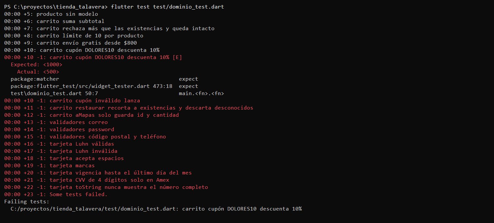

**VERDE** – Se revierte el cambio y las pruebas pasan

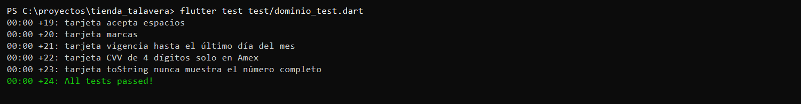

### Ronda 2 – Servicios (pasarela, checkout, bloqueo de intentos, auth)

**Archivo de pruebas:** `servicios_test.dart`

**Cambio para provocar el fallo:** `bloqueo_intentos.dart`: la cuenta se bloqueaba al sexto intento fallido en lugar del quinto.

**ROJO** – La prueba falla

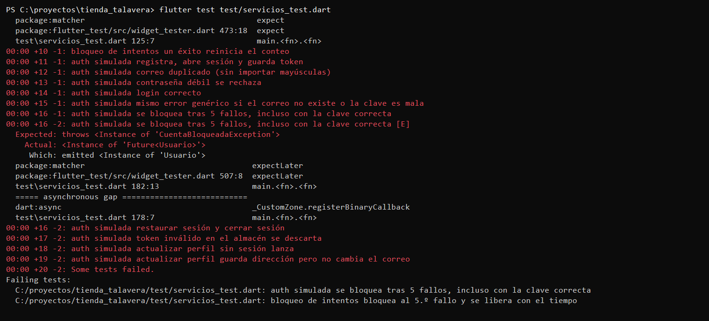

**VERDE** – Se revierte el cambio y las pruebas pasan

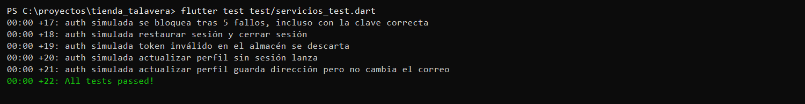

### Ronda 3 – ViewModels

**Archivo de pruebas:** `viewmodels_test.dart`

**Cambio para provocar el fallo:** `catalogo_vm.dart`: se quitó el filtro por categoría del catálogo.

**ROJO** – La prueba falla

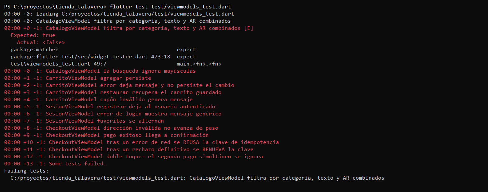

**VERDE** – Se revierte el cambio y las pruebas pasan

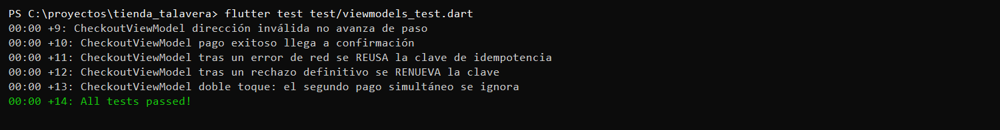

Al final, `flutter test` pasa las 60 pruebas (captura en la sección de evidencia).

## Carpetas

```
lib/
  dominio/dinero.dart
  dominio/producto.dart
  dominio/excepciones.dart
  dominio/carrito.dart
  dominio/validadores.dart
  dominio/direccion.dart
  dominio/usuario.dart
  dominio/orden.dart
  dominio/tarjeta.dart
  dominio/contratos.dart
  dominio/servicio_checkout.dart
  dominio/bloqueo_intentos.dart
  datos/pasarela_simulada.dart
  datos/auth_simulada.dart
  datos/almacenes.dart
  datos/catalogo_memoria.dart
  presentacion/vm/catalogo_vm.dart
  presentacion/vm/carrito_vm.dart
  presentacion/vm/sesion_vm.dart
  presentacion/vm/checkout_vm.dart
  presentacion/pantallas/pantalla_catalogo.dart
  presentacion/pantallas/pantalla_detalle.dart
  presentacion/pantallas/pantalla_carrito.dart
  presentacion/pantallas/pantalla_checkout.dart
  presentacion/pantallas/pantalla_perfil.dart
  presentacion/pantallas/pantalla_ver_en_tu_espacio.dart
  dependencias.dart
  main.dart
test/
  dominio_test.dart
  servicios_test.dart
  viewmodels_test.dart
```

## Cómo correrlo

```
flutter pub get
flutter test
flutter run -d chrome
```

Tarjetas de práctica de la pasarela simulada: `4242 4242 4242 4242` se aprueba y `4000 0000 0000 0002` se rechaza (cualquier fecha futura y CVV 123).

## Evidencia

Resultado de `flutter test` (son 60 pruebas en total: 24 del dominio, 22 de servicios y 14 de los ViewModels):

```
PS C:\proyectos\tienda_talavera> flutter test
00:01 +60: All tests passed!
```

Captura de la terminal:

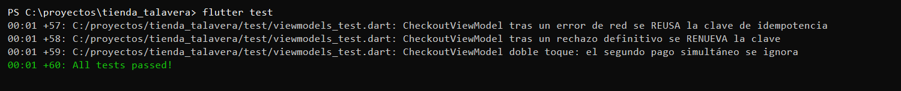

## Evidencia de la app funcionando

Se corrió como app web en Chrome, en la computadora, dentro de un marco del tamaño de un celular.

| Catálogo | Detalle del jarrón | "Ver en tu espacio": visor 3D |
|---|---|---|
| 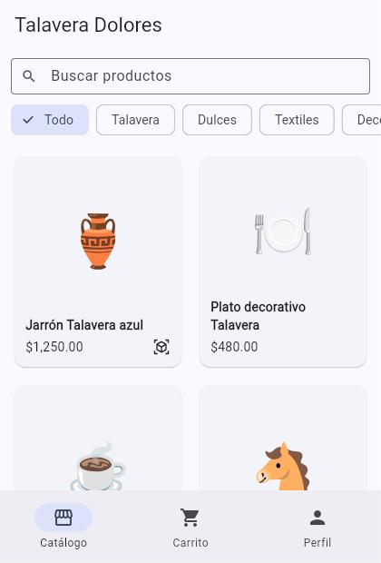 | 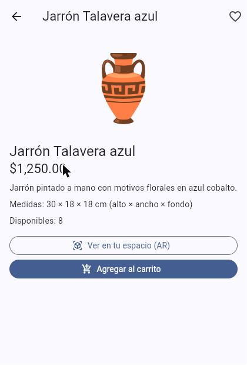 | 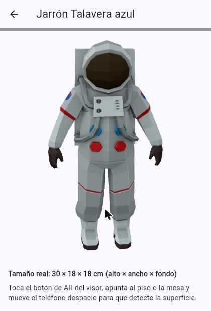 |

| Carrito con cupón DOLORES10 | Cuenta de prueba creada | Paso 1: dirección de envío |
|---|---|---|
| 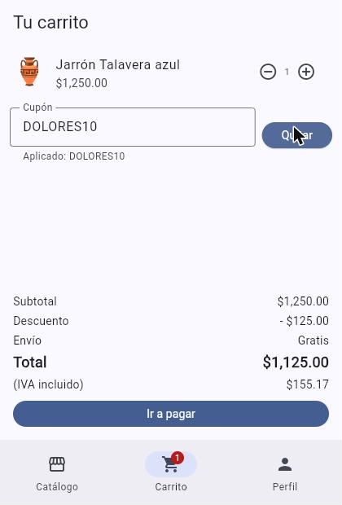 | 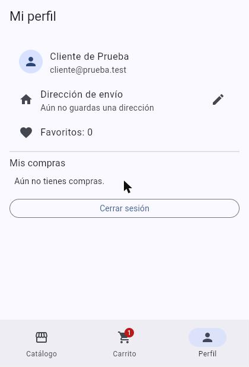 | 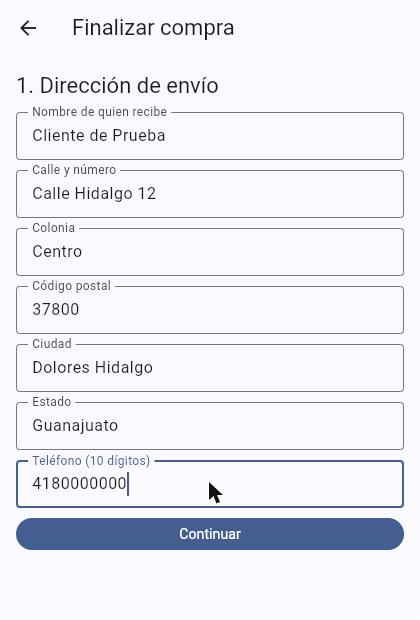 |

| Tarjeta 4000…0002: rechazada sin cargo | Tarjeta 4242…: compra exitosa | La orden aparece en "Mis compras" |
|---|---|---|
| 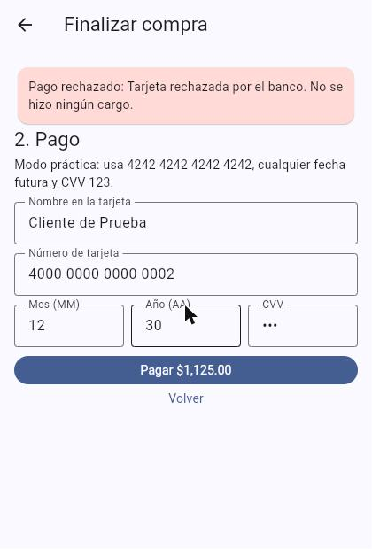 | 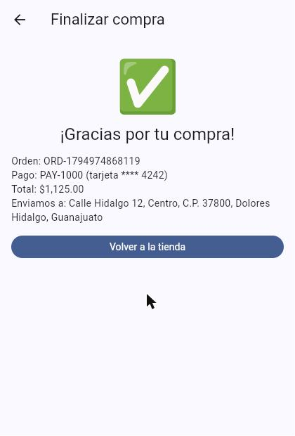 | 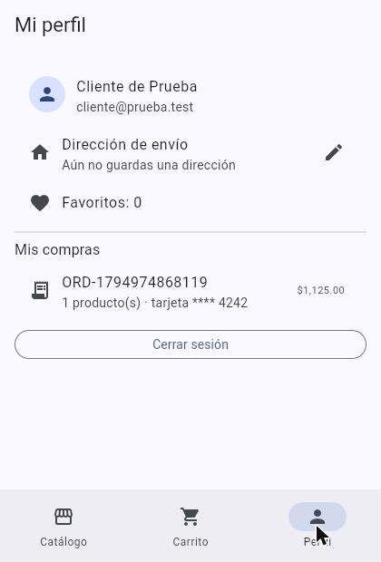 |

El modelo 3D es el astronauta de ejemplo de modelviewer.dev que trae el manual (solo para práctica). En la computadora se ve el visor 3D y se puede girar; el botón de realidad aumentada solo aparece en un teléfono compatible con ARCore o en un iPhone.
